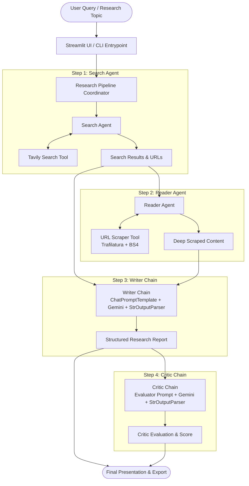

# 🔎 Multi-Agent Research System

[](https://www.python.org/)
[](https://www.langchain.com/)
[](https://streamlit.io/)
[](https://ai.google.dev/)
[](https://tavily.com/)

A modular, multi-agent AI research assistant built with **LangChain**, **Google Gemini**, **Tavily API**, and **Streamlit**. 

The system automates the end-to-end research workflow: it searches the live web for breaking news and technical data, autonomously selects and scrapes deep content from the most relevant source, synthesizes an exhaustive, structured research report, and subjects the findings to an automated peer-review critic for evaluation and scoring.

---

## 📑 Table of Contents

- [Key Features](#-key-features)
- [System Architecture](#-system-architecture)
- [Workflow Pipeline](#-workflow-pipeline)
- [Project Structure](#-project-structure)
- [Prerequisites & API Keys](#-prerequisites--api-keys)
- [Installation & Setup](#-installation--setup)
- [Running the Application](#-running-the-application)
  - [Interactive Web UI (Streamlit)](#1-interactive-web-ui-streamlit)
  - [Command-Line Interface (CLI)](#2-command-line-interface-cli)
- [Component Overview](#-component-overview)
  - [Tools (`src/tools/`)](#1-tools-srctoolstoolsypy)
  - [Agents & Chains (`src/agents/`)](#2-agents--chains-srcagentsagentspy)
  - [Pipeline Coordinator (`src/pipelines/`)](#3-pipeline-coordinator-srcpipelinespipelinespy)
- [Configuration & Customization](#-configuration--customization)
- [Troubleshooting](#-troubleshooting)
- [License](#-license)

---

## 🚀 Key Features

* **Autonomous Multi-Agent Architecture**: Uses specialized autonomous agents and LCEL (LangChain Expression Language) chains, each scoped to a single responsibility.
* **Live Web Retrieval**: Powered by Tavily Search API to gather real-time citations, titles, and snippets for any research query.
* **Resilient Deep Content Scraper**: Multi-tiered web scraper combining `trafilatura` for boilerplate-free article extraction and `BeautifulSoup4` with DOM-sanitization as an automated fallback.
* **Structured Report Synthesis**: Generates professional, publication-ready reports structured with an Executive Summary, Key Findings, Analytical Conclusions, and Source Citations.
* **Self-Reflective Critic & Scoring**: Employs an automated critic agent that evaluates the report strictly for objectivity, factual grounding, and completeness, providing a numerical score ($X/10$), categorized feedback, and a final verdict.
* **Interactive Streamlit Web Dashboard**: Real-time pipeline execution tracking with collapsible progress steppers (`st.status`), raw extraction inspection, markdown report preview, and one-click `.txt` report downloads.

---

## 🏛 System Architecture



---

## 🔄 Workflow Pipeline

The state is passed progressively across four deterministic stages:

1. **Step 1: Search Agent (`build_search_agent`)**
   - Receives the user's research topic.
   - Formulates targeted search queries and calls the Tavily Search API.
   - Extracts top ranked web results, URLs, and summaries.
2. **Step 2: Reader Agent (`build_reader_agent`)**
   - Analyzes the initial search hits.
   - Autonomously selects the most authoritative and content-rich URL.
   - Downloads the target page and strips boilerplate ads, navigation bars, and footers to retrieve the full article body.
3. **Step 3: Writer Chain (`writer_chain`)**
   - Combines search abstracts and scraped deep content into a comprehensive context prompt.
   - Directs Gemini to produce a well-argued, cohesive, structured report with citations.
4. **Step 4: Critic Chain (`critic_chain`)**
   - Inspects the output of the writer chain.
   - Evaluates factual depth, source grounding, and formatting.
   - Returns a structured breakdown: `Score: X/10`, `Strengths`, `Areas to Improve`, and `One line verdict`.

---

## 📂 Project Structure

```text
Multi-agent-Research-System/
├── app.py                      # Streamlit web application dashboard
├── main.py                     # CLI entrypoint for running research queries
├── requirements.txt            # Python dependencies
├── .env                        # Environment variables and API keys (create from template)
├── .gitignore                  # Git ignore file
├── README.md                   # Project documentation
└── src/
    ├── __init__.py
    ├── agents/
    │   ├── __init__.py
    │   └── agents.py           # Agent definitions (Search, Reader) and LCEL Chains (Writer, Critic)
    ├── pipelines/
    │   ├── __init__.py
    │   └── pipelines.py        # Pipeline orchestrator managing state across agent execution
    └── tools/
        ├── __init__.py
        └── tools.py            # LangChain tool definitions (Tavily search & URL scraper)
```

---

## 🔑 Prerequisites & API Keys

Before running the project, you will need active API keys for:

1. **Google AI Studio (Gemini)**:
   - Obtain a key from [Google AI Studio](https://aistudio.google.com/).
   - Required environment variable: `GOOGLE_API_KEY` (or `GEMINI_API_KEY`).
2. **Tavily Search API**:
   - Obtain a free API key from [Tavily](https://tavily.com/).
   - Required environment variable: `TAVILY_API_KEY`.

---

## ⚙️ Installation & Setup

### 1. Clone the Repository
```bash
git clone https://github.com/your-username/Multi-agent-Research-System.git
cd Multi-agent-Research-System
```

### 2. Create and Activate a Virtual Environment

**On Windows (PowerShell):**
```powershell
python -m venv .venv
.\.venv\Scripts\Activate.ps1
```

**On Linux / macOS:**
```bash
python3 -m venv .venv
source .venv/bin/activate
```

### 3. Install Dependencies
```bash
pip install --upgrade pip
pip install -r requirements.txt
```

### 4. Configure Environment Variables
Create a `.env` file in the root directory:
```env
# Google Gemini API Key
GOOGLE_API_KEY=your_google_gemini_api_key_here

# Tavily Search API Key
TAVILY_API_KEY=your_tavily_api_key_here
```

---

## 🖥 Running the Application

### 1. Interactive Web UI (Streamlit)

Launch the user-friendly Streamlit dashboard:

```bash
streamlit run app.py
```

* Open your browser at `http://localhost:8501`.
* Enter your topic (e.g. *"The impact of AI in job market in 2026"*).
* Click **🚀 Start Research** to monitor the live steppers, read the synthesized report, and download the output.

### 2. Command-Line Interface (CLI)

Run the automated pipeline directly from terminal:

```bash
python main.py
```

You can change the topic in `main.py`:
```python
from src.pipelines.pipelines import run_research_pipeline

topic = "Breakthroughs in Quantum Computing in 2026"
results = run_research_pipeline(topic)
```

---

## 🧩 Component Overview

### 1. Tools (`src/tools/tools.py`)
- **`web_search(query: str)`**: Queries the Tavily API and formats top search candidates into structured snippets containing titles, source URLs, and excerpts.
- **`url_scrapper(url: str)`**: Fetches HTML with a custom browser `User-Agent`. First attempts article text extraction with `trafilatura` (which handles HTML5 semantics and tables). If `trafilatura` fails, falls back to `BeautifulSoup4` with automated DOM tag decomposition (`<script>`, `<style>`, `<nav>`, `<footer>`, `<header>`).

### 2. Agents & Chains (`src/agents/agents.py`)
- **`build_search_agent()`**: Instantiates a LangChain tool-calling agent equipped with `web_search`.
- **`build_reader_agent()`**: Instantiates an agent equipped with `url_scrapper` to autonomously inspect target URLs.
- **`writer_chain`**: An LCEL chain (`ChatPromptTemplate | llm | StrOutputParser`) that synthesizes the combined raw data into a coherent 4-part research document.
- **`critic_chain`**: An LCEL evaluation chain that audits the written report for completeness, objectivity, and source attribution.

### 3. Pipeline Coordinator (`src/pipelines/pipelines.py`)
- Coordinates the flow of information across agents using an in-memory `state` dictionary:
  - `state["search_results"]`: Raw search output.
  - `state["scrapped_content"]`: Scraped article body.
  - `state["report"]`: Final markdown research report.
  - `state["feedback"]`: Reviewer critique and score.

---

## 🔧 Configuration & Customization

* **Change the LLM Model**:
  In `src/agents/agents.py`, you can change the model string in `ChatGoogleGenerativeAI`:
  ```python
  llm = ChatGoogleGenerativeAI(
      model="gemini-2.0-flash", # or "gemini-1.5-pro", "gemini-1.5-flash"
      temperature=0.2
  )
  ```
* **Adjust Search Breadth**:
  In `src/tools/tools.py`, configure `max_results` inside `web_search()`:
  ```python
  results = tavily.search(query=query, max_results=10)
  ```
* **Customize Report Formats**:
  Edit `writer_prompt` in `src/agents/agents.py` to change the mandatory report sections (e.g. adding Executive Summary, Financial Projections, or Risk Analysis).

---

## ❓ Troubleshooting

| Issue | Cause | Solution |
| :--- | :--- | :--- |
| `ModuleNotFoundError: No module named 'src'` | Running script directly from inside `src/` | Always execute from the repository root, or run with `python -m src.agents.agents` or `python main.py`. |
| `ValueError: API key required for Gemini Developer API` | Missing or mismatched `.env` key | Ensure `GOOGLE_API_KEY` or `GEMINI_API_KEY` is set in your `.env` file and `load_dotenv()` is called. |
| `404 Not Found: models/...` | Invalid Gemini model name | Use supported model names such as `"gemini-1.5-flash"`, `"gemini-1.5-pro"`, or `"gemini-2.0-flash"`. |
| `TypeError: Pregel.invoke() missing 1 required positional argument` | Incorrect dictionary passed to agent `.invoke()` | Pass messages as a dictionary: `agent.invoke({"messages": [("user", query)]})`. |

---

## 📜 License

This project is licensed under the MIT License. Feel free to use, modify, and distribute it for personal and commercial projects.
